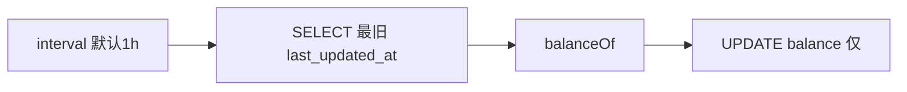

# 地址代币余额后台刷新（Balance Refresher）

本文档说明扫描器内「定期用链上 `balanceOf` 校准 `token_balances`」的设计与配置，便于后续查阅。

## 背景

- 解析 ERC20 `Transfer` 事件后，浏览器需要展示地址持有各代币的数量，数据落在表 `token_balances`。
- 扫块路径（`parseERC20Transfer`）可选两种策略：
  - **内联**：每笔 Transfer 对 `from`/`to` 调链上 `balanceOf` 并写入库（与当前交易快照一致）。
  - **非内联**（`scanner.skip_inline_balance_update: true`）：扫块不写链上余额，只维护「占位行」+ 后台任务统一刷新。

## 后台刷新在做什么

1. 按配置间隔（默认 **1 小时**）触发一轮。
2. 从 `token_balances` 中选出待刷新行（`JOIN contracts` 且 `contract_type = 'ERC20'`），按 `last_updated_at` **最旧优先**，每轮最多 `batch_size` 行。
3. 可选 `min_age`：只刷新「距离上次更新已超过该时间」的行，减少与扫块内联更新抢同一行。
4. 对每行并发（上限 `concurrency`）调用 `balanceOf`，再写库。
5. 写库使用 **`UpdateTokenBalanceFromChain`**：只更新 `balance` 与 `last_updated_at`，**不修改** `last_tx_hash` / `last_tx_block_number`，保留「最后一笔相关交易」的语义。

## 配置（`externaldb.toml`）

```toml
[erc20scan]
# true：扫块不调 balanceOf，仅用 touch 占位行 + 后台刷新（需启用下面的后台刷新）
skipInlineBalanceUpdate = false

[erc20scan.balanceRefresher]
enabled = false
interval = "1h"           # 默认 1h；未配置时程序内默认亦为 1h
batchSize = 50            # <=0 时默认 50
  concurrency: 5            # <=0 时默认 5
  min_age: ""               # 可选，如 30s；空表示不按时间过滤
```

## `touchBalanceRowInDB` 在做什么

当 **`skip_inline_balance_update: true`** 时，扫块阶段不能再用链上余额覆盖表，但仍需要让 `token_balances` 里出现 `(address, token)` 这一行，否则后台刷新任务**没有行可选**（刷新任务只遍历已有 `token_balances`）。

因此调用 **`UpsertTokenBalanceMetadata`**（对应代码里的 `touchBalanceRowInDB`）：

| 情况 | 行为 |
|------|------|
| 该 `(address, contract)` **还没有**行 | 插入一行，`balance` 先为 `0`，并带上当前这笔 Transfer 的 `last_tx_hash` / `last_tx_block_number`。 |
| **已经有**行 | 只更新 `last_tx_*` 与 `last_updated_at`，**不把 `balance` 改成 0**，避免覆盖扫块或上一轮后台已经写对的余额。 |

也就是说：**「保证行存在 + 记录最近一笔相关交易元数据」，在已存在行上不覆盖已有 `balance`**。真实余额由后续的 **`balance_refresher`** 用链上 `balanceOf` 写入。

若开启 `skip_inline_balance_update` 却 **未**开启 `balance_refresher.enabled`，占位行的 `balance` 可能长期不准，不推荐。

## 相关代码位置

| 模块 | 路径 |
|------|------|
| 配置默认值与解析 | `config/config.go`（`BalanceRefresherConfig`、`ParseBalanceRefresherDurations`） |
| 选批与仅更新余额 SQL | `database/models.go`（`ListTokenBalanceRowsForRefresh`、`UpdateTokenBalanceFromChain`、`UpsertTokenBalanceMetadata`） |
| 定时任务与并发刷新 | `scanner/process.go`（`runBalanceRefresher`、`refreshBalanceBatch`） |
| 启动后台协程 | `scanner/main.go`（`Init` 之后 `go runBalanceRefresher`） |

## 流程简图


